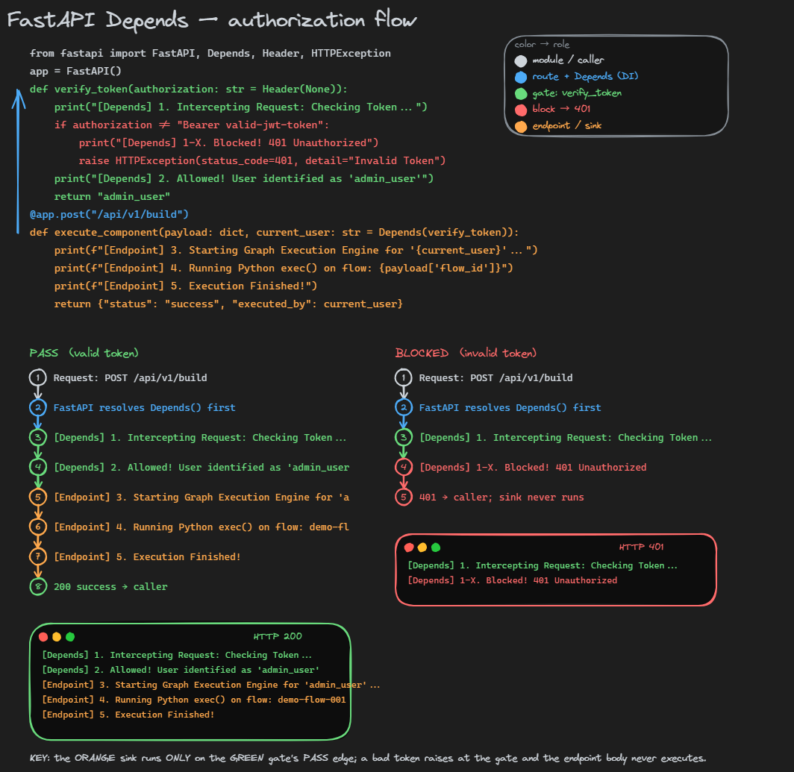

# figflow

Turn a runnable Python snippet into a themed **execution-flow figure** (dark,
hand-drawn Excalidraw style) — with the code, the step-by-step timeline, and the
terminal output all drawn deterministically, so **every character is exact**.



*Above: `auth-gate-flow` on a FastAPI `Depends` snippet — exported from Excalidraw.*

## Why it's faithful

The figure is built from the code, not drawn by an image model:

- **scopes / nesting** come from the AST,
- the **timeline + exact stdout** come from *actually running* the snippet
  (`sys.settrace` for plain code; `TestClient` requests for the auth flow),
- **roles** (gate / block / sink / route) come from static patterns.

A diffusion image model garbles code and labels; figflow never does — it emits an
SVG (for GitHub inline) and an editable `.excalidraw` from one shared layout.

## Figure-types

| type | story | code panel | example |
|------|-------|-----------|---------|
| `scope-flow` | nesting + call/return weaving between scopes | tinted concentric scope boxes | a decorator |
| `auth-gate-flow` | a `Depends()` gate branches PASS→sink / FAIL→401 | flat, colored by role | the image above |

Both share one theme (`render.py`'s `emit_*` helpers: title, legend, badge timeline,
terminal, fonts, colors, spacing), so figures never drift.

## Install

- `scope-flow`: Python stdlib only.
- `auth-gate-flow`: needs `fastapi` + `httpx` (run via `uv`, below).
- rasterize SVG→PNG (optional): `uvx --from cairosvg cairosvg fig.svg -o fig.png`.

## Usage

```bash
# scope-flow — any runnable snippet
python render.py --code mysnippet.py --concept "Python decorator" \
    --out figflow-out/figure --fmt both          # -> figure.svg + figure.excalidraw

# auth-gate-flow — a FastAPI route with Depends (drives 2 real requests)
uv run --with fastapi --with httpx python auth_gate.py \
    --code examples/fastapi_depends.py --out figflow-out/authgate --fmt both
```

Each run writes a `.svg` (clean; renders inline on GitHub) and a `.excalidraw`.

### Hand-drawn look (the image in this README)

figflow's own `.svg` is clean, not sketchy. The hand-drawn look comes from
Excalidraw's engine, so to get it:

1. drag the generated `.excalidraw` onto <https://excalidraw.com>,
2. select all (Ctrl+A),
3. **Export image → SVG** (or PNG), dark background.

(For full automation you'd render the `.excalidraw` with a headless-browser tool
like `excalidraw_export`; the manual export above is simplest.)

### Optional: Gemini aesthetic reference

`run.py --generate` sends the prompt to a Gemini image model (needs
`google-genai` + `GEMINI_API_KEY`). It is **secondary** — good for a vibe, but it
garbles text, so the deterministic renderer above is the real output.

## Pieces

| file | role |
|------|------|
| `figflow.py` | IR extraction (AST scopes + `settrace` timeline/stdout + static roles), orchestrator, Gemini backend |
| `render.py` | shared theme + `emit_*` components + `to_svg` / `to_excalidraw`; `scope-flow` layout |
| `auth_gate.py` | `auth-gate-flow`: infer route/token, drive valid/invalid requests, branch render |
| `run.py` | CLI for `scope-flow` (+ optional Gemini) |
| `examples/` | input snippet + the exported example image |

## Adding a figure-type

Reuse `render.py`'s `emit_title / emit_legend / emit_timeline / emit_terminal` so
the theme stays consistent; only the code-panel treatment is per-type.

## Notes / limits

- The snippet is **executed** to trace it — only run code you trust.
- `auth-gate-flow` builds its timeline from captured **stdout** (process-wide),
  not `settrace`: `TestClient` runs the app in a worker thread where a main-thread
  tracer never fires.
- Timeline step/label tuning lives in `render.py` constants (`LH`, `STEP_H`, `INDENT`,
  `BADGE_R`) and box depth in `tint()` / the `inset` in `layout()`.
